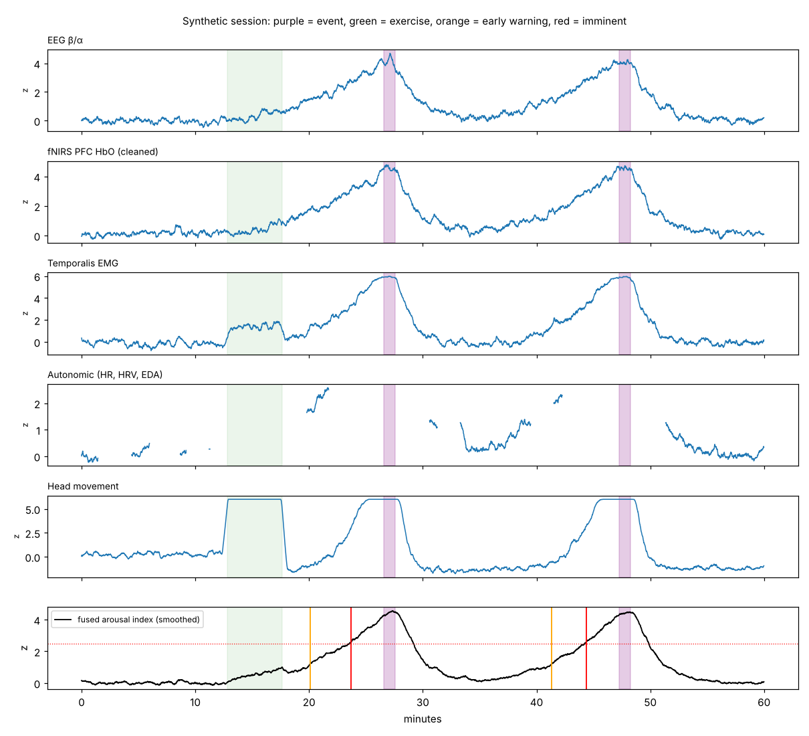

# calm-helmet

**A multimodal sensing helmet for early warning of autistic meltdowns and challenging behaviour.**
Research prototype. **Not a medical device.**

The helmet combines dry **EEG**, prefrontal **fNIRS / HD-DOT** (near-infrared brain imaging), temporalis **EMG**, forehead **PPG**, a head **IMU**, and a wrist **EDA** sensor. Each signal is compared with the wearer's own calm baseline, and the signals are fused into one arousal index. The person, a caregiver or staff then get a two-level alert while there is still time for a calm break, less stimulation or de-escalation.

> Many people who need this kind of support already wear a **protective helmet** because of head-directed self-injury. Building the sensors into that helmet avoids the biggest practical obstacle: tolerating yet another device.

📐 Design document: [`docs/DESIGN.md`](docs/DESIGN.md). It covers the sensors and where they go, the near-infrared imaging, the signal processing, the lab track (OPM-MEG, wearable PET), next-generation sensing, the validation plan and ethics.

Sister project: the EEG-only prototype in [netanelcyber/psi-qeeg-bis/meltdown-alert](https://github.com/netanelcyber/psi-qeeg-bis/tree/main/meltdown-alert).

---

## Pipeline

```
 EEG (β/α, rel. α) ─┐
 fNIRS HbO/HbR ─► short-separation cleaning ─┤
 EMG temporalis ────┤                         robust z vs personal baseline
 HR, HRV, EDA ──────┤  ─► (gated off while the IMU shows exercise) ─► weighted fusion ─► arousal index
 IMU (context) ─────┘                                                        │
                                   ┌─────────────────────────────────────────┴───────────────┐
                        one-sided CUSUM + rising trend                    smoothed index ≥ 2.5 z for 10 s
                                   │                                                         │
                          EARLY WARNING (target ≤ 10 min)                             IMMINENT ALERT
```

**Key design choices**

- **fNIRS quality check.** An optional 2.5-minute verbal fluency task measures this person's prefrontal response. If it is weak or noisy, fNIRS is weighted down instead of driving false alerts. The metrics are a quality check and a research profile, **not** a diagnostic test.
- **Personal baseline.** Each feature is scored as a robust z (median/MAD) against the wearer's own calm calibration (3 minutes). The baseline then adapts slowly, and only while the wearer is calm.
- **Short-separation fNIRS.** Arousal raises blood flow in the scalp, and a long fNIRS channel would report that as brain activity. An ~8 mm channel sees only the scalp, so its signal is subtracted. The coupling is fitted on calm data only, because during a build-up the cortical and scalp signals rise together.
- **Movement gating.** Exercise raises HR and EDA just like stress does. While the head IMU shows clear physical activity, and for 2 minutes after, the autonomic features are left out. Cortical and muscle channels carry the index during that time.
- **Graceful degradation.** Weights are renormalised over whatever is valid each second. If fNIRS loses contact, the index continues without it. No alerts are sent when fewer than 2 modalities are valid.
- **One build-up, one early warning.** The early-warning level re-arms only after 5 calm minutes.

## Quick start

```bash
pip install -r requirements.txt
python -m calm_helmet --out docs/synthetic_validation.json --plot docs/demo.png
pytest -q
```

## Synthetic benchmark

12 simulated sessions of 60 minutes with 2 events each (24 events), plus 4 simulated hours with **no events** but with harmless stress spikes and physical exercise. Full numbers: [`docs/synthetic_validation.json`](docs/synthetic_validation.json).

| Configuration | Early warning, median (range) | Missed | False alarms in 4 quiet hours |
|---|---|---|---|
| **Full helmet + wrist** | **6.4 min** (5.3–9.2) | 1 | 3 |
| fNIRS *without* short-separation cleaning | 5.9 min (3.2–11.8) | 1 | 8 |
| Full, with fNIRS contact loss 15% of the time | 6.4 min (5.2–9.2) | 1 | 5 |
| EEG only | 6.6 min (5.6–7.7) | 1 | 0 |
| fNIRS only | 6.7 min (5.2–9.7) | 1 | 2 |
| EEG + fNIRS + EMG | 6.1 min (5.3–9.2) | 1 | 0 |
| Wrist-style autonomic only, no movement gating | 7.6 min (6.9–14.9) | 3 | 27 |



**How to read this, honestly:**

- The simulator **assumes** that cortical and muscle signals rise gradually over 15 minutes before an event. If that assumption is wrong, these numbers mean nothing. They only show that the software behaves as designed.
- What the table *does* show is how the design choices behave under these assumptions. Short-separation cleaning cuts false alarms caused by scalp blood flow. Movement gating is what keeps autonomic signals usable. Losing fNIRS contact degrades the system gracefully.
- The one missed event is two events close together. The second build-up starts before the first episode has calmed down, so the imminent level never re-arms. Real life will have harder cases than this.
- Published wrist-sensor studies reach about **1–3 minutes** of warning (Goodwin et al. 2019, 2023). Whether a helmet can extend that toward 10 minutes is the research question, not a result.

## Project layout

```
calm_helmet/
  config.py     features, weights, all thresholds
  simulate.py   synthetic multimodal sessions (assumptions spelled out)
  fnirs.py      short-separation regression
  calibration.py  verbal fluency task: fNIRS quality check and trait profile (not diagnostic)
  fusion.py     personal baseline, movement gating, weighted index
  detector.py   CUSUM early warning, imminent alert, hysteresis
  evaluate.py   lead time, missed events, false alarms
  pipeline.py   glue
  plot.py       session figure
tests/          pytest suite
docs/           DESIGN.md, benchmark JSON, demo figure
```

The pipeline works on **1 Hz feature streams**. Raw-signal processing (EEG band powers, fNIRS optical density → HbO/HbR via the modified Beer–Lambert law, PPG → HR/HRV, EMG RMS, IMU activity) belongs in per-device adapters. These are not written yet.

## Ethics

The purpose is earlier, gentler help. The system must never be used to justify restraint, seclusion, forced medication or punishment. Use it only with informed consent, or under the appropriate legal and ethical framework where capacity is limited. Alerts go to people who know the wearer. Physiological data are sensitive health data, so store as little as possible, encrypt it, and comply with GDPR, the Israeli Privacy Protection Law, or HIPAA as applicable. See [`docs/DESIGN.md`](docs/DESIGN.md#ethics-and-safe-use).

## Contact

Netanel Stern, independent clinical AI developer (Israel). Collaboration with research groups, clinicians, helmet makers and fNIRS/EEG device makers is very welcome. WhatsApp: +972557743883

## License

MIT
