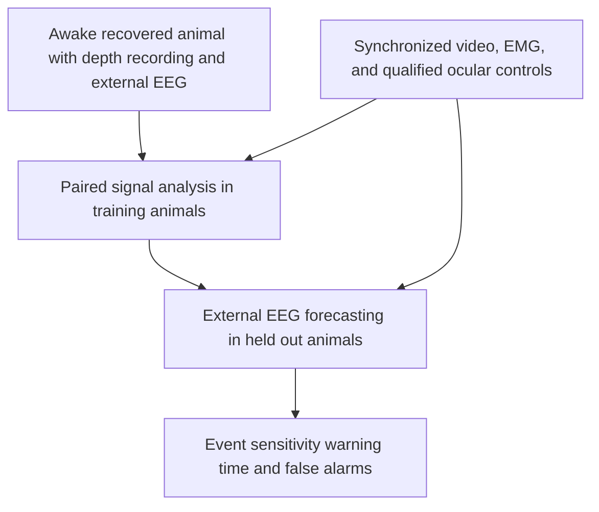

# A framework for validating neural signals before aggressive behavior in animal models relevant to autism and schizophrenia

Netanel Stern

Independent researcher, Israel

Correspondence: nsh531@gmail.com

Article type: Hypothesis and proposed validation framework

Version 1.2 | 27 October 2026 | Manuscript draft, not peer reviewed

## Abstract

Neural activity preceding aggressive action has been described in animal experiments, but its translation into an externally measurable warning signal remains unresolved. This article proposes a framework for testing whether depth recordings contain information about subsequent attacks that can also be recovered from external electroencephalography (EEG). The framework distinguishes a neural correlate of an ongoing attack, a correlate of stable aggressive tendencies, and a signal that forecasts a future attack with a measurable warning interval. It considers four experimental conditions: controls, an autism spectrum disorder relevant model, a schizophrenia relevant model, and a combined condition whose validity must be established independently. These conditions represent experimental constructs rather than clinical diagnoses in animals. Simultaneous depth electrophysiology, external EEG, video, and muscle activity would be recorded in awake animals after recovery from implantation. Analysis would first establish reproducible temporal associations between recording modalities and then evaluate forecasting with external EEG alone. Validation would separate animals and recording sessions across training and testing, control for movement and social investigation, and quantify event sensitivity, warning time, precision, and false alarms per hour. Rodent studies provide evidence for neural information preceding aggressive action; primate studies provide complementary examples of disease relevant mechanisms and scalp EEG measurements. Neither evidence stream establishes a validated predictor of aggression in a combined autism and schizophrenia model. No new animals, recordings, fitted models, or experimental results are reported here. The contribution is a falsifiable framework for determining whether such a translational biomarker exists.

Keywords: aggression; attack forecasting; electroencephalography; local field potential; autism spectrum disorder; schizophrenia; animal models; translational validation

## 1 Research question and scope

The central question is whether information available before an animal initiates an attack can support an external EEG warning signal with useful lead time and an acceptable false alarm burden. Three distinct observations must be kept separate. A neural feature can accompany an attack, correlate with an individual's behavioral history, or forecast a future attack during continuous recording. Only the third observation establishes a candidate warning signal. Differences between diagnostic model groups do not establish this capability.

Depth recordings offer a way to investigate the first part of this problem. In male mice, activity in the ventrolateral ventromedial hypothalamus (VMHvl) was associated with the likelihood of a subsequent attack and the latency to the next attack. Pre-attack firing was also associated with subsequent attack duration [1]. Other work found changes in local field potential (LFP) power during aggressive encounters [2] and population dynamics associated with an escalating internal aggressive state [3]. These findings motivate a prospective forecasting question without demonstrating that the same information is accessible from scalp EEG.

The proposed framework concerns observable attack behavior in animal models. It does not equate territorial or defensive behavior with the clinical, social, and legal meanings of human violence. It also does not assume that autism spectrum disorder (ASD), schizophrenia (SCZ), or their co-occurrence identifies an aggressive individual. In a human EEG study, alpha peak frequency and microstate features correlated with aggression measures, but this design did not validate imminent event forecasting [4]. Clinical application would therefore require separate evidence beyond the animal work proposed here.

## 2 Evidence supporting the hypothesis

Falkner and colleagues recorded VMHvl neuronal activity during social encounters in male mice. Their analyses related activity during investigation to a later attack and related firing in the second before attack onset to attack duration [1]. The finding establishes temporally relevant information in an aggression related circuit. It does not provide a universally applicable alarm threshold, a validated warning horizon, or evidence of equivalent information in external EEG.

Yang and colleagues recorded LFPs from the medial prefrontal cortex, medial amygdala, and ventromedial hypothalamus in mice with different social rearing histories. Gamma activity in the right ventromedial hypothalamus increased during attacks relative to the period before attacks in socially isolated animals [2]. This result is especially useful as a caution: an attack associated gamma increase may detect an ongoing action rather than forecast its onset.

Nair and colleagues identified a slowly evolving dimension of hypothalamic population activity associated with aggressive escalation [3]. Their measurements involved calcium imaging and population modeling, rather than scalp EEG. A long time constant of an internal neural state is not equivalent to a demonstrated warning interval of that duration. It provides a hypothesis about a latent state that could be evaluated using electrophysiology.

Together, these studies support testing for a neural precursor while leaving its external observability unresolved. The specific hypothesis proposed here is that a reproducible change in neural state precedes some attacks, influences a measurable cortical or extracranial signal, and improves prediction beyond concurrent behavior and generalized arousal. Each part of that hypothesis can fail independently.

## 3 Disease relevant models and the combined condition

ASD relevant models can inform the interpretation of baseline and sensory responses. Awake Fmr1 knockout mice show increased resting gamma power and reduced sound evoked gamma synchronization [5]. Elevated baseline gamma in such a model cannot be treated automatically as evidence of an approaching attack. In a parallel mouse and human study, prenatal valproate exposed mice and children with ASD showed corresponding abnormalities in auditory response timing and gamma phase locking, measured with electrophysiology in mice and magnetoencephalography (MEG) in children [6]. That result demonstrates a translational strategy for sensory physiology, not an aggression predictor.

Shared genetic mechanisms also require careful interpretation. Distinct ASD associated and SCZ associated Shank3 alleles produced overlapping and divergent synaptic and behavioral phenotypes in mice [7]. Such comparisons do not establish an animal with both human disorders. The 22q11.2 deletion provides another route to studying overlapping neurodevelopmental and psychiatric vulnerability. In Df1/+ mice, auditory evoked potential growth and adaptation depended partly on hearing phenotype; some abnormalities remained evident regardless of hearing impairment [8]. Hearing sensitivity and experimental state must therefore be measured rather than assumed equivalent across groups.

The four conditions in Table 1 define a proposed experimental structure. The combined condition is an unresolved model development task. A genotype combined with a pharmacological manipulation can test an interaction between those manipulations, but it cannot be called validated ASD plus SCZ comorbidity solely because each manipulation has previously been linked to one disorder. Developmental timing, target engagement, cognition, sensory processing, and behavioral specificity would require independent characterization.

Table 1 Proposed experimental conditions

| Condition | Intended construct | Required interpretation |
| --- | --- | --- |
| Control | Matched reference animals | Controls can also show attacks; group membership is not the event label |
| ASD relevant | A specified genetic or developmental mechanism | The model represents selected ASD relevant features |
| SCZ relevant | A specified circuit, genetic, or receptor mechanism | The model represents selected SCZ relevant features |
| Combined | Interaction between the two specified mechanisms | Combined validity must be established before interpreting comorbidity |

Baseline phenotype and event forecasting should be analyzed separately. A stable group difference can provide mechanistic information while having no value for predicting when an attack will occur. Conversely, a useful state signal might occur across all four conditions. The experimental design should allow both outcomes.

## 4 Species selection for translation

Rodents provide access to established genetic models and extensive research on attack related circuits. They are appropriate for testing whether a candidate precursor exists and whether it survives controls for movement and social investigation. Their advantages do not eliminate differences in brain geometry, cortical organization, and the meaning of the behavior across species.

Nonhuman primates can provide a subsequent bridge for selected mechanisms and measurements. In 2026, a study of F1 heterozygous SHANK3 mutant macaques reported atypical social behavior, cognitive differences, and diminished EEG responses to auditory stimulation [9]. In rhesus macaques, NMDA receptor blockade reduced scalp recorded mismatch negativity and P3a responses in a paradigm linked to sensory processing abnormalities relevant to SCZ [10]. These are examples of mechanism and measurement translation; they do not demonstrate a common primate model of ASD and SCZ or a forecast of attack behavior.

Marmosets provide another relevant measurement example. A 2026 study recorded noninvasive scalp EEG in nine eye contact deficit marmosets and nine controls and evaluated sensory gating and auditory steady state responses [11]. Eye contact deficit is a behavioral phenotype rather than a complete clinical ASD diagnosis. The study establishes the feasibility of relevant scalp measurements, without establishing an aggression warning signal.

Species choice should follow the unanswered question. A closer anatomical relationship to humans does not by itself validate behavioral prediction. A primate stage would be justified only when a specific translational limitation remains after evidence from existing data and lower burden approaches. All four experimental conditions should be evaluated within a consistent species and measurement framework before cross-species group effects are interpreted.

## 5 Simultaneous depth and external recordings

The proposed measurement combines depth electrophysiology, an external EEG montage, synchronized video, electromyography (EMG), and movement measurements. Implantation and other research surgery would occur under an approved animal care protocol. The primary recordings for attack forecasting would be obtained in awake animals after documented recovery and habituation. Measurements obtained during anesthesia could support technical or mechanistic characterization, but would not substitute for measurements preceding awake behavior.

The term external EEG requires a precise recording description. Scalp electrodes, electrodes on the skull beneath the skin, epidural electrodes, and electrodes on the cortical surface differ in invasiveness and signal transfer. Jonak and colleagues demonstrated a 30 channel array on the mouse skull surface in awake freely moving animals [12]. This supports multisite recording feasibility but is not equivalent to an intact scalp measurement. An eventual claim about noninvasive translation would require explicit validation at that recording level.

Depth targets would be selected from a prespecified circuit hypothesis rather than chosen after observing the strongest behavioral association. VMHvl is motivated by attack related evidence [1], while cortical recordings could test whether an accessible network representation accompanies the deeper state. The final target set, electrode characteristics, anatomical verification, and acceptable recording quality would need to be specified by the implementing laboratory. This article provides no surgical coordinates, implantation instructions, or completed experiment.

All recording streams would share synchronization events, and residual timing error would be measured. Independent or appropriately assessed references are necessary because a shared reference can create apparent depth to surface coupling. Recording quality, recovery status, time of day, medication or experimental exposure, sleep and wake state, and any welfare related interruption would be retained in the analysis record. Figure 1 summarizes the proposed validation sequence.

Figure 1 Proposed validation sequence. No experimental results are shown.

### 5.1 Proposed ocular monitoring and acquisition quality

The existing EMG, movement, video, and reference controls do not explicitly identify eye movements or blinks. Rodent video-EEG guidance emphasizes montage-specific artifacts and synchronization [17]. Simultaneous EEG/EOG/EMG has been used in freely moving rats for sleep-wake measurements [18]; eye cameras with electrophysiology have been demonstrated in freely moving mice [19], and bilateral eye tracking has been used during prey capture [20]. These establish measurement feasibility in those settings, not validated ocular-artifact rejection during social attacks. Human EEG work distinguishes corneo-retinal, eyelid, and saccadic spike contributions and finds limitations of both regression and ICA [21]. Its thresholds and performance must not be transferred to animals without testing.

The implementing laboratory would select and document an ocular-monitoring route before confirmatory recording:

| Recording context | Proposed ocular measurements | Required qualification |
| --- | --- | --- |
| Awake freely moving mice or rats | Separate periocular EOG derivations where feasible, eye-resolving video, or both; synchronized head pose and arena video | Pilot each species, age, and montage; lateral eyes and eye-head coupling make head movement alone an inadequate eye measure. Assess both eyes where possible; validate any single-eye limitation. |
| Nonhuman primate scalp EEG | Horizontal and vertical EOG derivations where feasible, supplemented or replaced by calibrated eye-resolving video | Qualify blink and saccade detection in the intended posture and movement context; head-fixed performance does not validate free social behavior. |
| Skull-surface, epidural, cortical-surface, or depth recordings | The same independent ocular checks, adapted to recording geometry and reference | Intracranial proximity does not prove immunity; assess channel-specific ocular coupling rather than applying a human scalp template. |

EOG would be acquired as separate auxiliary channels, not included in an EEG average reference. Electrode geometry, differential derivations, references, acquisition bandwidth, sampling, and clock alignment would be reported. Horizontal and vertical sensitivity would be tested separately; a single derivation cannot be presumed to capture every blink or eye movement. EOG can itself contain neural, facial-muscle, or mechanical contributions, so it is an indicator rather than a pure signal to subtract automatically. Additional electrodes or cameras require species-appropriate welfare and behavioral-burden assessment.

Eye video would resolve eyelid closure and pupil/eye position relative to the head, rather than merely whole-body motion. Report frame rate, exposure, spatial resolution, illumination, tracking confidence, visibility of each eye, dropped frames, and synchronization drift. Pilot timing and detection against manually annotated blinks and rapid movements, with an independent annotated sample and inter-rater agreement. An occluded eye, failed pupil fit, or inadequate frame rate is missing ocular information, not evidence of a clean interval; eyelid closure does not reveal movement behind the lid.

Before confirmatory testing, a species/montage-specific pilot would freeze numerical criteria for contact impedance or the system's equivalent contact-quality measure, clipping, flatlines/dropouts, drift, line noise, abrupt amplitude/slope changes, eye-event detection, tracking failure, timing tolerance, and minimum usable channels. Robust baseline amplitude and derivative statistics are candidate detectors, not universal thresholds. Sampling and anti-aliasing would cover the highest analyzed frequency. Compare raw traces, spectra, spatial patterns, and eye-event-triggered responses across EOG, EEG, EMG, and head motion, including matched non-attack behaviors. Failure to qualify the ocular-monitoring route would limit interpretation or require redesign before confirmatory claims; no such pilot or acceptance result is reported here.

## 6 Defining baseline and the future event

Two baselines are necessary. The reference group baseline describes differences between model conditions. The individual baseline describes an animal's stable physiology during matched states. Baseline estimates should be obtained from data available before the prediction period. Updating a baseline with information from future attacks would introduce leakage.

The attack endpoint would be an observable behavior defined in an ethogram and annotated from video by raters blinded to neural features and, where feasible, model condition. Onset uncertainty and inter-rater agreement would be reported. Investigation, threat display, attack initiation, and sustained attack should be labeled separately. A neural change before a bite but after an attack movement has begun may be useful for action decoding, while providing little opportunity for preventive warning.

Candidate forecasting horizons, for example 1, 5, 10, or 30 seconds, would be prespecified as analysis targets rather than claimed performance. Repeated attacks within an encounter require a definition of event clusters, recovery intervals, and eligible time at risk. A primary horizon and endpoint should be chosen before confirmatory evaluation. Secondary horizons would be labeled accordingly and assessed with multiplicity control.

Negative examples must include challenging comparisons. Quiet rest alone is an inadequate control for an active social attack. Relevant non-attack periods include social investigation, locomotion, grooming, and other permitted arousal states with similar movement intensity. Seizure activity and recording artifacts require separate annotation. Their presence must not be silently relabeled as aggression.

## 7 Linking the depth signal to external EEG

The first analysis would establish whether a prespecified depth feature has a reproducible external correlate. Candidate features include band limited power envelopes, burst duration, event related spectral changes, and selected phase relations. Feature sets should remain small enough to support interpretable testing and avoid unrestricted searches across every channel, frequency, and time lag.

Power envelope correlations and lagged cross-correlations would describe shared temporal variation. Magnitude squared coherence would quantify frequency specific consistency between signals. These statistics establish association, not source identity or causal direction. A genuine depth source may reach external sensors with approximately zero lag through volume conduction, while spurious coupling can arise from a common reference or a third source. The interpretation therefore depends on the specific question being asked.

EMG is a central control. Scalp activity above 20 Hz can contain substantial muscle contributions [13]. During social encounters, apparent high frequency neural effects may reflect jaw, neck, or movement activity. Analyses should compare neural features with recorded EMG and kinematics, examine appropriately matched periods, and determine whether the association survives conservative artifact exclusion. Statistical adjustment alone is insufficient when an artifact dominates the measurement.

For questions about interaction between distinct neural populations, imaginary coherency and the weighted phase lag index provide useful sensitivity analyses against some instantaneous mixing effects [14,15]. They do not remove all confounding and can miss true interactions with little phase lag. They should not be imposed as mandatory tests for detecting the same source through different recording geometries. Re-referencing sensitivity, anatomical plausibility, and surrogate analyses remain necessary.

Surrogate tests would preserve important temporal structure while disrupting the proposed depth to external alignment, using shifts or block based procedures longer than the relevant autocorrelation interval. The surrogate scheme would be selected before confirmatory analysis and avoid shifts that repeatedly align distinct attack periods. Uncertainty would be summarized at the animal level rather than treating thousands of correlated time windows as independent observations.

### 7.1 Ocular labels and contaminated windows

All rules below are proposed. Preserve raw data and annotate intervals before feature extraction. Keep observable events (`blink`, `eye_movement`) separate from electrical-artifact judgments (`ocular_suspected`, `ocular_supported`), other failures (`emg_motion`, `clipping`, `dropout`, `bad_reference`), and `ocular_unassessable`. A visible eye event alone does not prove electrical contamination, and an EEG/EOG correlation alone does not prove a non-neural origin. Supported ocular contamination would require convergent event timing and montage-consistent electrical evidence under prespecified rules. For a conservative primary analysis, exclude suspected or supported ocular artifacts and detected eye-event intervals even when electrical contamination remains uncertain; explicitly acknowledge that this also removes genuine eye-related neural activity.

For each annotation retain animal/session, onset/offset, affected channels, evidence source, confidence, detector/version or rater, and the time the flag became available. Keep the attack labels separate. Reviewers would be blinded to neural prediction scores, model condition where feasible, and later attack outcomes. Set event padding from pilot timing uncertainty and measured acquisition/filter transients, not from whichever padding improves prediction.

A feature window would be invalid if any required channel's complete input support, including preprocessing history, overlaps a flagged interval or lacks qualified ocular coverage. A prespecified validated reduced montage may be analyzed separately; silently changing channels by window is not allowed. Missing EOG is not automatically fatal if the prequalified video-only route provides adequate coverage, and vice versa. If neither qualified route covers the interval, mark it unassessable and exclude it from the primary clean-window analysis.

Do not interpolate across excluded gaps, replace them with zeros, concatenate separated intervals for spectral analysis, or compute coherence/phase estimates across gaps. Restart causal processing after a gap with a documented warm-up rule. Keep rejected windows and their reasons in the audit record. A separate retrospective mask may include evidence or backward padding unavailable online; it must not retrospectively alter the prospective alarm log.

### 7.2 Sensitivity to ocular exclusion and correction

Repeat depth-to-external analyses with a fixed feature set and animal-level splits using: technically usable data before ocular exclusion; the conservative clean-window set; prespecified stricter masks and alternative references; and, only if qualified, an EOG-regression or ICA correction branch. Fit correction weights/components on training or explicitly permitted earlier calibration data only, then freeze them. Sparse or rank-deficient montages may not support meaningful ICA. Inspect residual eye-locked waveforms, spectral/topographic changes, and preservation of clean reference segments; reduced EOG correlation alone is insufficient evidence of successful correction [21]. Primary inference would not depend on correction rescuing rejected intervals.

Report associations, animal-level uncertainty, and changes in direction and magnitude, not only significance. Report excluded duration and window/event counts by animal, condition, behavior, and time relative to attack; check whether exclusion preferentially removes active or pre-attack periods. Compare methods on their common retained intervals as well as their own coverage. Add ocular/head-motion/EMG-only comparators and matched non-attack eye events. A disappearing effect would leave neural specificity unsupported; a surviving effect would support robustness under these controls, not prove source identity or validated forecasting.

Repeat forecasting under the same prespecified masks, reporting both a frozen-model mask-only comparison and separately retrained pipelines whose fitting and tuning use training animals only. Apply each gate consistently to EEG and behavioral comparators; compare on shared assessable time and on the complete eligible timeline. Do not select the exclusion rule or correction method that performs best on test animals.

## 8 Forecasting and independent validation

The decisive test would use external EEG alone at prediction time. Depth data could identify candidate mechanisms or guide feature selection within training data, but could not supply unavailable information to the external EEG test model. Any mapping between modalities would be fitted using training animals only.

Three baseline predictors would anchor the analysis: behavioral history and context; video derived movement and EMG; and external EEG. A combined predictor would test whether EEG adds information beyond the behavioral measurements. A depth based predictor would provide a mechanistic comparison. If depth recordings forecast attacks but external EEG does not, the correct conclusion is a limitation of external observability, not successful translation.

Training, tuning, and evaluation would be separated by animal, with a further future session evaluation when individual calibration is a target. Standardization, feature selection, threshold choice, and any representation learning would be restricted to training partitions. Overlapping windows from the same encounter must not be split between training and testing. Causal preprocessing is required for warning claims; an offline filter or smoother that uses future samples can manufacture an apparently early signal.

Continuous recording evaluation is necessary. Performance on a balanced set of selected pre-attack and rest windows can substantially misrepresent the burden of alarms in ordinary observation. The primary report would include the proportion of events warned, the distribution of warning intervals, positive predictive value, false alarms per hour of eligible recording, and time spent under warning. Precision-recall summaries, probability calibration, and animal level confidence intervals would supplement these results. No target accuracy is assumed in this proposal.

### 8.1 Artifact-aware forecasting without future information

The clean-window analyses in Section 7 are retrospective tests of neural specificity. A continuous forecasting evaluation would additionally replay acquisition in chronological order, preserving every emitted alarm and quality decision. For a feature window ending at time t, preprocessing, baseline updates, eye tracking, artifact decisions, and features may use only samples and fitted parameters available by the actual decision time. Prohibit forward-backward filtering, centered smoothing or derivatives, future-frame interpolation, full-session normalization, and ICA or detector fitting on held-out sessions. Fit preprocessing and quality thresholds within training partitions; any animal-specific calibration must precede its evaluation interval and be reported separately.

If a detector requires a later frame or post-event confirmation, delay the decision explicitly. Define warning time from actual alarm emission, including acquisition, buffering, detection, feature, and computation latency, rather than from the nominal EEG window endpoint. An alarm emitted at or after attack onset cannot count as a forecast. Future attack annotations may define evaluation outcomes, but cannot choose features, masks, or thresholds. A retrospective ocular label or backward mask cannot cancel an earlier false alarm. Purge boundaries in time-split calibration/evaluation so that feature histories, overlapping windows, and future-label horizons do not cross partitions; animal holdout remains mandatory for generalization claims.

The external-EEG-only predictor would consume EEG features alone. An EOG/video-assisted quality gate would be declared as an auxiliary-sensor system and evaluated separately, with those sensors available at deployment. Claims about a complete EEG-only system require an independently qualified EEG-only gate. EOG/video information used only for offline auditing would not be available to an online EEG-only gate or classifier. Missingness and rejected-window indicators would not silently become neural predictors.

The online gate would abstain when contemporaneously available evidence indicates invalid or unassessable input. Report usable-time coverage, abstention duration, and event-level warning sensitivity both across all prespecified eligible attacks (an attack with no timely emitted warning remains unwarned) and within the assessable subset. Physiological eligibility rules would be fixed independently of signal quality. Report false alarms per assessable hour and per total eligible hour with both denominators, along with precision, warning time, and time under warning. Retain quality-related unavailable periods on the timeline; do not improve apparent performance by deleting difficult pre-attack intervals. Incomplete follow-up at recording end would be censored under prespecified outcome rules, not counted as a confirmed non-event.

## 9 Testing the four conditions

The four conditions support two related analyses. One asks whether neural and external measurement features differ at baseline. The other asks whether features change before attacks and whether the size or predictive meaning of those changes differs by condition. A factorial model can test the interaction of the two specified experimental factors; adding behavioral state allows a test of whether that interaction changes in the pre-attack period.

Animals and sessions should be modeled as clustered observations. Event counts alone cannot replace an adequate number of independent animals. Sample size planning would require pilot estimates of attack frequency, between-animal variation, within-animal dependence, missing data, and the desired precision of the primary forecasting endpoint. No defensible confirmatory sample size can be assigned from the conceptual framework alone.

A condition by state interaction would support a mechanistic difference if replicated, but would not automatically establish a diagnostic classifier or a useful warning system. Generalization must be tested both within and across model conditions. A feature that improves predictions only in a selected subgroup should be reported with that limitation. A model that uses group membership while showing little within-animal predictive value would not answer the central research question.

## 10 Falsifiable hypotheses and failure criteria

The first hypothesis is that a prespecified depth feature changes before attack onset after accounting for movement, EMG, ocular events/artifacts, and non-aggressive social behavior. Failure to replicate the change in independent animals would weaken the proposed mechanism.

The second hypothesis is that a reproducible correlate of that feature can be recovered from external EEG. A strong depth association with no reliable external correlate would identify a translation barrier. Successful correlation alone would still leave behavioral prediction unproven.

The third hypothesis is that external EEG improves future attack prediction over behavioral history, video, and EMG at a prespecified warning horizon. A benefit that disappears under animal level holdout, causal preprocessing, conservative ocular-artifact exclusion, or movement matching would fail this test.

The fourth hypothesis is that the combined experimental condition modifies either the underlying physiology or the prediction relationship beyond the effects of its component manipulations. A null interaction would support a shared or additive account within the tested design. It would not imply that human ASD and SCZ comorbidity lacks biological importance.

MEG could provide a later complementary test of external observability when species, sensor geometry, implant compatibility, and movement conditions permit it. The evidence reviewed here does not establish a MEG based pre-attack warning signal in an ASD or SCZ relevant animal model. MEG should therefore remain a separately justified extension rather than a presumed solution to an abnormal EEG baseline.

## 11 Animal welfare and reproducibility

Any implementation would require prospective institutional and veterinary approval, documented scientific justification for invasive recording, and species appropriate welfare safeguards. The research objective does not justify injury as an endpoint. Existing recordings, noninvasive measurements, and lower burden designs should be considered before new invasive experiments or a primate stage. Humane stopping rules and welfare related missingness must be reported because they can also affect the interpretation of behavioral data.

An implemented study should follow ARRIVE 2.0 reporting principles, including experimental design, sample size justification, inclusion and exclusion rules, randomization, blinding, outcome definitions, and statistical methods [16]. The present article is not a registered or approved animal protocol. No ethics approval identifier is claimed.

Future data sharing should include synchronized timing information, recording geometry, references, preprocessing details, ocular-monitoring qualification, behavior and artifact labels, onset uncertainty, exclusions, quality-flag availability times, immutable alarm logs, and immutable animal level train-test splits. Code should reproduce event based evaluation as well as feature extraction. Negative results, particularly failure of a depth signal to transfer to scalp EEG, would be scientifically informative and should remain reportable.

## 12 Conclusion

Existing animal studies justify investigating neural information before aggressive action. They do not establish that a clinically relevant warning signal can be recovered from external EEG, or that a combined ASD and SCZ relevant model has been validated. Simultaneous depth and external recordings in awake recovered animals can test that bridge. The essential evidence would be reproducible pre-attack physiology, a defensible external correlate, and independently evaluated forecasting that improves on behavior and movement measurements. This article specifies those tests without reporting experimental validation.

## Data and code availability

No new dataset was collected, downloaded for analysis, or statistically reanalyzed for this article. No predictive model was trained. The article is based on the cited literature and a proposed study design. No prospective study registration is claimed.

## Author information

Netanel Stern is the proposed sole author and corresponding author, identified as an independent researcher based in Israel. No institutional endorsement or additional authorship is asserted.

## Funding

The author declares that no funding was received for this work.

## Conflicts of interest

The author declares no conflicts of interest.

## Use of artificial intelligence

OpenAI ChatGPT assisted with literature discovery, drafting, organization, and document preparation based on the author's research questions. Bibliographic details and evidence summaries were checked against retrieved publication records. No experimental data, fitted models, numerical validation results, or biological images were generated. The human author must review the complete manuscript and accept responsibility for its content before submission.

## References

[1] Falkner AL, Dollar P, Perona P, Anderson DJ, Lin D. Decoding ventromedial hypothalamic neural activity during male mouse aggression. Journal of Neuroscience. 2014;34(17):5971-5984. https://doi.org/10.1523/JNEUROSCI.5109-13.2014

[2] Yang J, et al. High-Frequency Local Field Potential Oscillations May Modulate Aggressive Behaviors in Mice. Biology. 2022;11(11):1682. https://doi.org/10.3390/biology11111682

[3] Nair A, Karigo T, Yang B, et al. An approximate line attractor in the hypothalamus encodes an aggressive state. Cell. 2023;186(1):178-193.e15. https://doi.org/10.1016/j.cell.2022.11.027

[4] Murphy M, Carrion RE, Rubio J, Malhotra AK. Peak alpha frequency and electroencephalographic microstates are correlated with aggression in schizophrenia. Journal of Psychiatric Research. 2024;175:60-67. https://doi.org/10.1016/j.jpsychires.2024.04.051

[5] Lovelace JW, Ethell IM, Binder DK, Razak KA. Translation-relevant EEG phenotypes in a mouse model of Fragile X Syndrome. Neurobiology of Disease. 2018;115:39-48. https://doi.org/10.1016/j.nbd.2018.03.012

[6] Gandal MJ, Edgar JC, Ehrlichman RS, Mehta M, Roberts TPL, Siegel SJ. Validating gamma oscillations and delayed auditory responses as translational biomarkers of autism. Biological Psychiatry. 2010;68(12):1100-1106. https://doi.org/10.1016/j.biopsych.2010.09.031

[7] Zhou Y, Kaiser T, Monteiro P, et al. Mice with Shank3 Mutations Associated with ASD and Schizophrenia Display Both Shared and Distinct Defects. Neuron. 2016;89(1):147-162. https://doi.org/10.1016/j.neuron.2015.11.023

[8] Lu C, Linden JF. Auditory evoked-potential abnormalities in a mouse model of 22q11.2 Deletion Syndrome and their interactions with hearing impairment. Translational Psychiatry. 2025;15:4. https://doi.org/10.1038/s41398-024-03218-x

[9] Jiang M, Li R, Yang X, et al. Behavioral phenotypes and neuronal biomarkers in F1 mutant macaque model of SHANK3-associated autism spectrum disorders. Neuron. 2026. https://doi.org/10.1016/j.neuron.2026.04.018

[10] Gil-da-Costa R, Stoner GR, Fung R, Albright TD. Nonhuman primate model of schizophrenia using a noninvasive EEG method. Proceedings of the National Academy of Sciences of the United States of America. 2013;110(38):15425-15430. https://doi.org/10.1073/pnas.1312264110

[11] Kimura K, et al. Sensory gating and auditory steady-state response analysis of eye contact deficit marmosets using a noninvasive scalp EEG system. Journal of Neurophysiology. 2026;136(2):679-688. https://doi.org/10.1152/jn.00582.2025

[12] Jonak CR, Lovelace JW, Ethell IM, Razak KA, Binder DK. Reusable Multielectrode Array Technique for Electroencephalography in Awake Freely Moving Mice. Frontiers in Integrative Neuroscience. 2018;12:53. https://doi.org/10.3389/fnint.2018.00053

[13] Whitham EM, Pope KJ, Fitzgibbon SP, et al. Scalp electrical recording during paralysis: quantitative evidence that EEG frequencies above 20 Hz are contaminated by EMG. Clinical Neurophysiology. 2007;118(8):1877-1888. https://doi.org/10.1016/j.clinph.2007.04.027

[14] Nolte G, Bai O, Wheaton L, Mari Z, Vorbach S, Hallett M. Identifying true brain interaction from EEG data using the imaginary part of coherency. Clinical Neurophysiology. 2004;115(10):2292-2307. https://doi.org/10.1016/j.clinph.2004.04.029

[15] Vinck M, Oostenveld R, van Wingerden M, Battaglia F, Pennartz CMA. An improved index of phase-synchronization for electrophysiological data in the presence of volume-conduction, noise and sample-size bias. NeuroImage. 2011;55(4):1548-1565. https://doi.org/10.1016/j.neuroimage.2011.01.055

[16] Percie du Sert N, Hurst V, Ahluwalia A, et al. The ARRIVE guidelines 2.0: Updated guidelines for reporting animal research. PLoS Biology. 2020;18(7):e3000410. https://doi.org/10.1371/journal.pbio.3000410

[17] Kadam SD, D'Ambrosio R, Duveau V, et al. Methodological standards and interpretation of video-EEG in adult control rodents. A TASK1-WG1 report of the AES/ILAE Translational Task Force of the ILAE. Epilepsia. 2017;58(Suppl 4):10-27. https://doi.org/10.1111/epi.13903

[18] Kumar R, Ramaswamy R, Nath Mallick B. Local Properties of Vigilance States: EMD Analysis of EEG Signals during Sleep-Waking States of Freely Moving Rats. PLoS ONE. 2013;8(10):e78174. https://doi.org/10.1371/journal.pone.0078174

[19] Meyer AF, Poort J, O'Keefe J, Sahani M, Linden JF. A Head-Mounted Camera System Integrates Detailed Behavioral Monitoring with Multichannel Electrophysiology in Freely Moving Mice. Neuron. 2018;100(1):46-60.e7. https://doi.org/10.1016/j.neuron.2018.09.020

[20] Michaiel AM, Abe ETT, Niell CM. Dynamics of gaze control during prey capture in freely moving mice. eLife. 2020;9:e57458. https://doi.org/10.7554/eLife.57458

[21] Plöchl M, Ossandón JP, König P. Combining EEG and eye tracking: identification, characterization, and correction of eye movement artifacts in electroencephalographic data. Frontiers in Human Neuroscience. 2012;6:278. https://doi.org/10.3389/fnhum.2012.00278
