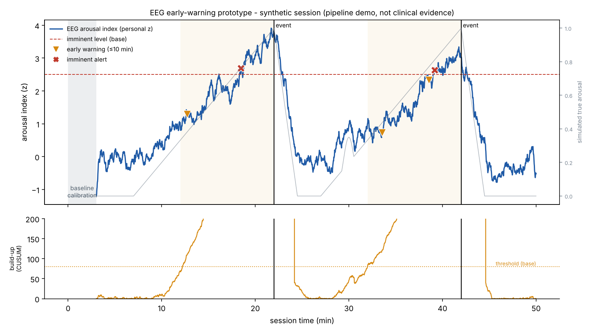

# EEG Early Warning: autistic meltdowns and psychotic agitation (research prototype)

Open-source pipeline that reads EEG from a wearable headband, tracks a **personalised arousal index**, and sends a **two-level alert** to the person, a caregiver or the clinical team. There are two profiles: `meltdown` (autistic meltdowns, 10-minute horizon) and `psychosis` (agitation and aggression risk in acute psychosis, 20-minute horizon, optionally combined with the Brøset Violence Checklist).

| Level | Meaning | Typical lead time on the synthetic test set* |
|---|---|---|
| **Early warning** | A slow, sustained rise in arousal has built up while the trend is still rising. Aimed at a horizon of **up to 10 minutes** (configurable). | median 8.4 min (range 6.7–10.1) |
| **Imminent** | Arousal is far above the person's own baseline and has stayed there. | median 2.4 min (range 0.5–6.1) |

\* 12 held-out simulated sessions with 24 events, plus 4 hours of simulated sessions with stress spikes but no meltdowns. **0 missed events and 0 false alarms** (`meltdown` profile). See [`docs/synthetic_validation.json`](docs/synthetic_validation.json). These numbers come from simulated data, **not** from people. Read the [limitations](#limitations-read-this) section.



Psychosis profile with a BVC score of 3 entered at minute 4: [`docs/demo_psychosis_bvc.png`](docs/demo_psychosis_bvc.png).

📐 **Full algorithm specification, with equations, pseudocode and the evaluation protocol: [`docs/ALGORITHM.md`](docs/ALGORITHM.md).**

> ⚠️ **Not a medical device.** This is a research prototype for exploring whether EEG can contribute to early warning of autistic meltdowns. Do not use it to make care decisions.

---

## Why EEG, and why a personal baseline

Wearable studies using heart rate, electrodermal activity (EDA), skin temperature and movement have forecast aggression, self-injury and meltdowns in autistic youths about **1–3 minutes** ahead (Goodwin et al., *JAMA Network Open*, 2023). EEG adds a view of **cortical** arousal that peripheral signals do not capture. The hypothesis is that slower cortical changes may appear earlier and extend the warning window towards ~10 minutes. **That hypothesis is untested.**

Physiology differs a lot between people, especially autistic people. So the index is built from each person's own calm baseline (median/MAD robust z-scores) instead of population thresholds.

## How it works

```
EEG stream ─► 2 s windows (1 s hop) ─► artifact rejection ─► features ─► robust z vs personal baseline
                                                                             │
                                          weighted arousal index ◄───────────┘
                                                   │
                       ┌───────────────────────────┴──────────────────────────┐
             one-sided CUSUM + rising trend                    smoothed level ≥ 2.5 z for 10 s
                       │                                                       │
             EARLY WARNING (≤10 min)                                    IMMINENT ALERT
                       └──────────────► console / webhook / WhatsApp ◄─────────┘
```

**Features per window:**

| Feature | What it reflects | Direction during rising arousal |
|---|---|---|
| β/α log-ratio | cortical activation | ↑ |
| relative α power | alpha suppression | ↓ |
| relative θ power | | ↓ (small weight) |
| frontal α asymmetry, ln(αR) − ln(αL) | withdrawal / negative affect | ↓ |
| 30–45 Hz power | mostly scalp **muscle tension (EMG)** on dry headbands, not neural gamma | ↑ |

**Alert logic and false-alarm control:**
- **Calibration.** The first 3 minutes of a session, in a calm state, set the baseline. The baseline then adapts slowly, but only while the person is calm.
- **Early warning.** Uses a one-sided CUSUM on the index. CUSUM accumulates small persistent rises, so it reacts minutes earlier than a level threshold would. It fires only if the 3-minute trend is still rising by at least 0.05 z/min. When the trend allows, the alert includes a projected time to the imminent level.
- **Imminent alert.** Fires when the smoothed level stays above 2.5 z for 10 seconds.
- **Hysteresis.** Once an alert has fired, it can fire again only after the level drops back below 1 z. On top of that there is a 5-minute refractory period per alert level.
- **No early warnings during an active imminent episode.**
- **Signal quality.** No alerts are sent while fewer than 60% of recent windows are clean. A window is rejected if it is too large (blink or movement) or flat (lost contact).

## Quick start

```bash
pip install -r requirements.txt

# 1) Synthetic demo (no hardware): prints alerts, an evaluation and saves a plot
python -m eeg_alert --source synthetic --plot docs/demo.png

# 2) Muse headband (TP9, AF7, AF8, TP10 @ 256 Hz)
pip install muselsl pylsl
muselsl stream            # in another terminal
python -m eeg_alert --source lsl --fs 256 --channels TP9 AF7 AF8 TP10 --frontal AF7 AF8

# 3) OpenBCI (OpenBCI GUI → Networking → LSL, type EEG)
python -m eeg_alert --source lsl --fs 250 --channels Fp1 Fp2 F3 F4 --frontal F3 F4

# 4) Replay a recording (CSV: one column per channel in µV; optional 'timestamp' column)
python -m eeg_alert --source csv --file session.csv --fs 256
```

### Sending alerts to a caregiver

```bash
# WhatsApp via Twilio (credentials only from environment variables)
export TWILIO_ACCOUNT_SID=...  TWILIO_AUTH_TOKEN=...
export TWILIO_WHATSAPP_FROM=whatsapp:+14155238886
export ALERT_WHATSAPP_TO=whatsapp:+972XXXXXXXXX
python -m eeg_alert --source lsl --notify console whatsapp

# Any webhook (Home Assistant, IFTTT, Slack, a phone app ...)
python -m eeg_alert --source lsl --notify console webhook --webhook-url https://example.org/hook
```

### Tuning the horizon

| Option | Default | Effect |
|---|---|---|
| `--profile` | meltdown | `meltdown` (10 min) or `psychosis` (20 min) |
| `--horizon-min` | from profile | Overrides the target warning horizon, which is also the window used to score early warnings |
| `--bvc-file` | none | CSV of Brøset Violence Checklist observations (see below) |
| `--cusum-h` | 80 | Lower means earlier warnings but more false alarms |
| `--cusum-k` | 0.3 | Ignores rises smaller than this many z per window |
| `--baseline-sec` | 180 | Length of the calm calibration period |

## Onset map: where on the scalp did the change start?

Every alert includes a **sensor-level onset map**. For each electrode the detector keeps a personal baseline and a CUSUM of two per-channel indices: a *neural* index (β/α up, relative α down) and a *muscle* index (30–45 Hz). When an alert fires it reports:

- the **earliest-changing region** (e.g. "right frontal (AF8), 6.6 min before this alert"),
- whether that first change was **cortical** or **probably muscle tension**,
- a **left/right lateralisation index** for the cortical change, and
- the order in which the other regions followed.

Example alert text:

```
[38:33] EARLY WARNING | index +2.33 z | trend +0.43 z/min
  Onset map (sensor level, not a brain focus): earliest change at right frontal (AF8), 6.6 min before this alert -
  cortical (beta/alpha) change; cortical change is bilateral (R-L index -0.08); then left temporoparietal (neural), ...
```

**Why this is not a "brain focus".** Unlike epileptic seizures, meltdowns and psychotic agitation are not known to start from a focal generator. A 4–8-electrode dry headband also cannot localise sources: the inverse problem is badly under-determined, and scalp changes reflect the reference, volume conduction and, at the forehead and temples, muscle. The onset map is useful for checking signal quality, for consistency within one person across episodes, and for generating research hypotheses. It should not be read as "where the outburst came from". A real source-space analysis (≥32 channels, digitised positions, MNE-Python eLORETA on band-power change) is a possible next step for laboratory recordings.

## Psychosis profile: agitation and aggression risk

```bash
python -m eeg_alert --source lsl --profile psychosis --bvc-file bvc.csv --notify console webhook --webhook-url https://...
```

**What it does.** The `psychosis` profile tracks the same personalised arousal and agitation index, with more weight on muscle tension (motor agitation). It aims at a **20-minute** horizon: wristband studies on psychiatric wards found heart rate and skin conductance rising over about the 20 minutes before aggressive incidents (de Looff et al., *Psychophysiology*, 2019). Its alert texts point to early, voluntary **de-escalation**.

**Brøset Violence Checklist (BVC).** The BVC is a validated six-item ward tool: confused, irritable, boisterous, verbally threatening, physically threatening, attacking objects. Each item scores 1 point if present *relative to the patient's usual behaviour*. A total of 1–2 means moderate risk and more than 2 means very high risk of violence within 24 hours. A recent BVC score does not raise an alert by itself. Instead it makes the physiological detector more sensitive for 24 hours:

| BVC | Early-warning threshold | Imminent level |
|---|---|---|
| 0 | unchanged | unchanged |
| 1–2 (moderate) | ×0.8 | −0.25 z |
| >2 (very high) | ×0.65 | −0.5 z, plus a one-time clinical notice |

`bvc.csv` format (one row per observation; items are 0/1):

```
time_min,confused,irritable,boisterous,verbal_threats,physical_threats,attacking_objects
4,0,1,1,1,0,0
```

Synthetic results for this profile (12 held-out sessions with 24 events, plus 4 hours of sessions with stress spikes but no events; BVC entered at minute 4):

| | Early warning (median, range) | Imminent (median) | Missed | False alarms, 4 h without events |
|---|---|---|---|---|
| No BVC | 8.9 min (6.8–10.4) | 3.5 min | 0 | 0 |
| BVC 1 (moderate) | 9.6 min (6.8–11.2) | 4.4 min | 0 | 2 |
| BVC 3 (very high) | 9.9 min (6.8–11.4) | 5.3 min | 0 | 5 |

The trade-off is intended: a high BVC buys earlier warnings at the cost of more false alarms. The same caveats apply: the simulator assumes a gradual build-up, and none of this has been tested on people. Full numbers are in [`docs/synthetic_validation.json`](docs/synthetic_validation.json).

**What it cannot do.** It does not tell an autistic meltdown apart from psychotic agitation. That is the purpose of the PSI indices in the parent repository, and they are not clinically validated either. Aggression in psychosis is uncommon, and most people with psychosis are never violent. A risk flag is a prompt for support, not a judgement about a person.

## Ethics and safe use

- **Purpose.** Earlier, gentler help: a calm break, less stimulation, de-escalation, a conversation. It must never be used to justify restraint, seclusion or forced medication, or to punish anyone.
- **Consent and control.** Use only with informed consent, or the appropriate legal and ethical framework where capacity is limited. The person (and their family, where appropriate) should know what is measured, who gets alerts, and how to stop monitoring.
- **Human in the loop.** Alerts go to people who know the person. False alarms and missed events will happen.
- **Privacy.** Physiological and clinical data are sensitive health data. Store them minimally, securely and under the applicable law (e.g. GDPR, Israeli Privacy Protection Law, HIPAA).
- **Stigma.** Report results at group level and avoid language that equates a diagnosis with dangerousness.

## Limitations (read this)

1. **No real meltdown data yet.** All performance numbers come from a simulator that *assumes* how EEG changes before a meltdown: alpha suppression, a beta rise, right-frontal shift and rising muscle tension over 15 minutes. Real pre-meltdown EEG may look different, change later, or vary from person to person. The synthetic results only show that the software works as designed.
2. **Artifacts are the main obstacle.** During agitation, movement and muscle activity dominate wearable EEG. The 30–45 Hz feature deliberately uses muscle tension as a signal, but a validated system must separate it from neural activity, or confirm that this is not needed.
3. **Tolerance.** Many autistic people have sensory sensitivities, and headbands may not be tolerated. Wrist-worn signals (HR, HRV, EDA, temperature, motion) are better proven and better tolerated. EEG is best seen as a **complement**, and the next version should fuse both.
4. **10 minutes is a target, not a result.** Published wearable studies achieve about 1–3 minutes. Whether 10 minutes is achievable in real life is the open research question this project aims to test.

## Validation plan

1. **Feasibility and tolerance.** Short daily wear by autistic volunteers, with consent and ethics approval, and carer involvement where appropriate. Measure wear time, comfort and signal quality.
2. **Labelled data.** Continuous EEG together with wrist sensors. Caregivers record events in an app (onset time, severity, context).
3. **Offline evaluation.** Leave-one-person-out and leave-one-session-out. Report lead-time distribution, sensitivity, false alarms per hour, and the effect of personal calibration.
4. **Fusion.** Compare EEG only, wrist only, and EEG plus wrist.
5. **Prospective pilot.** Live alerts to caregivers, with alert burden and usefulness rated by families.

## Project layout

```
eeg_alert/
  config.py     all tunable parameters
  sources.py    SyntheticEEG, LSLSource (Muse/OpenBCI), CSVSource
  features.py   band powers, ratios, asymmetry, artifact checks
  detector.py   personal baseline, arousal index, CUSUM early warning, imminent alert
  profiles.py   meltdown / psychosis profiles (weights, horizon, guidance text)
  clinical.py   Brøset Violence Checklist context that modulates sensitivity
  onset.py      sensor-level onset map (earliest-changing region, lateralisation, neural vs muscle)
  notify.py     console / webhook / WhatsApp (Twilio)
  pipeline.py   sliding-window glue
  evaluate.py   lead time and false alarms against labelled events
  plot.py       session figure
tests/          pytest suite
docs/           demo figure and synthetic validation results
```

Run the tests from this folder with `pytest -q`. This sub-project is self-contained: it does not depend on the parent `psi_qeeg` package, and the repository CI does not run its tests.

## Related work

- Goodwin MS et al. Wearable biosensing to predict imminent aggressive behavior in psychiatric inpatient youths with autism. *JAMA Network Open* (2023). Multi-site inpatient study with about 3-minute forecasting.
- Kushki A, Anagnostou E et al. *Anxiety Meter*: heart-rate-based real-time anxiety feedback for autistic youth (Holland Bloorview).
- Nuske HJ et al. *KeepCalm*: wearable heart-rate stress alerts for teachers of autistic children (Penn).
- Picard RW et al. Electrodermal activity and autonomic arousal in autism (MIT Media Lab).
- de Looff P, Noordzij ML, Moerbeek M, Nijman H, Didden R, Embregts P. Changes in heart rate and skin conductance in the 30 min preceding aggressive behavior. *Psychophysiology* 56(10), 2019.
- Almvik R, Woods P, Rasmussen K. The Brøset Violence Checklist: sensitivity, specificity, and interrater reliability. *Journal of Interpersonal Violence*, 2000.

## Contact

Netanel Stern, independent clinical AI developer (Israel). Also see [PenuX](https://penux.uk).
Collaboration with research groups, clinicians and device makers is very welcome. WhatsApp: +972557743883

## License

MIT (same as the parent repository)
