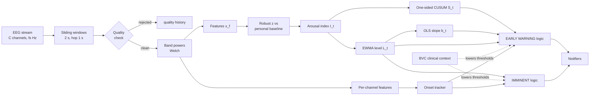
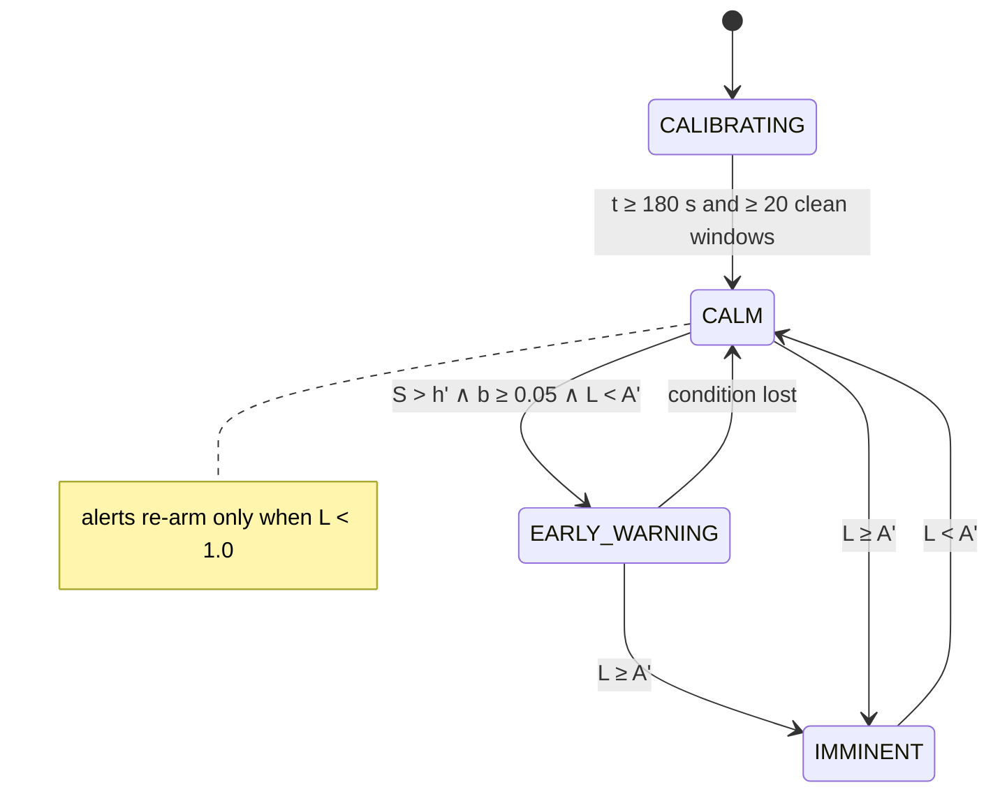

# Algorithm specification: personalised EEG early warning

**Version 0.1 · Netanel Stern · research prototype, not a medical device**

This document specifies the algorithm implemented in [`eeg_alert/`](../eeg_alert). Every equation and default value below matches the code. The goal is to turn a continuous wearable-EEG stream into two kinds of alert:

1. an **early warning** when a slow, sustained rise in arousal is building up, aimed at about **10 minutes** before an autistic meltdown (20 minutes for the psychosis-agitation profile), and
2. an **imminent alert** when arousal is already far above the person's own baseline.

Each alert also carries a **sensor-level onset map**.

---

## 1. Overview



## 2. Notation

| Symbol | Meaning | Default |
|---|---|---|
| $f_s$ | sampling rate | 256 Hz (Muse), 250 Hz (OpenBCI) |
| $C$ | channel set | TP9, AF7, AF8, TP10 |
| $W$, $\Delta$ | window length, hop | 2 s, 1 s |
| $t$ | time at the end of the current window | s |
| $x_{f,t}$ | value of feature $f$ in window $t$ | |
| $\tilde\mu_f,\ \tilde\sigma_f$ | robust baseline centre and scale of feature $f$ | |
| $z_{f,t}$ | robust z-score | |
| $w_f$ | feature weight (set by the profile) | §7 |
| $I_t$ | raw arousal index | z units |
| $L_t$ | smoothed level | z units |
| $b_t$ | trend slope | z / min |
| $S_t$ | CUSUM statistic | z · windows |
| $A$ | imminent level | 2.5 |
| $h$, $k$ | CUSUM threshold and reference | 80, 0.3 |

## 3. Windowing

The stream is buffered and cut into overlapping windows $X_t \in \mathbb{R}^{|C| \times N}$, with $N = W f_s$ samples, every $\Delta$ seconds. All later steps run once per window, so the decision rate is 1 Hz.

## 4. Pre-processing and quality control

A window is **rejected**, and contributes nothing except to the quality history, if any channel has

$$\max_n X_{c,n} - \min_n X_{c,n} > 250\ \mu V \quad\text{(blink, movement, electrode pop)}$$

or

$$\operatorname{std}_n X_{c,n} < 0.5\ \mu V \quad\text{(flat line / lost contact)},$$

or contains non-finite values.

Clean windows are filtered with a zero-phase 4th-order Butterworth band-pass (1–45 Hz) and 2nd-order band-stop filters at 50 ± 2 Hz and 60 ± 2 Hz.

**Signal quality.** $q_t$ is the fraction of the last 60 windows that passed. Alerts are suppressed while $q_t < 0.6$.

## 5. Features

The power spectral density $P_c(\phi)$ is estimated per channel with Welch's method (segment length $\min(N, f_s)$). Band power is

$$B_{c}^{\text{band}} = \sum_{\phi \in \text{band}} P_c(\phi)\,\Delta\phi,$$

with bands δ 1–4, θ 4–8, α 8–13, β 13–30 Hz and "high" 30–45 Hz. On dry headbands the high band is dominated by scalp EMG, so it is treated as **muscle tension** rather than neural gamma. With $T_c = B^\delta_c + B^\theta_c + B^\alpha_c + B^\beta_c$, the per-window features, averaged over channels, are:

| Feature $f$ | Definition | Interpretation |
|---|---|---|
| `alpha_rel` | $\overline{B^\alpha_c / T_c}$ | alpha suppression lowers it |
| `theta_rel` | $\overline{B^\theta_c / T_c}$ | |
| `beta_alpha_ratio` | $\overline{\ln B^\beta_c - \ln B^\alpha_c}$ | cortical activation |
| `muscle_tension` | $\overline{\ln B^{\text{high}}_c}$ | EMG / agitation |
| `frontal_asymmetry` | $\ln B^\alpha_{R} - \ln B^\alpha_{L}$ on the frontal pair (AF8, AF7) | lower = relatively more right-frontal activity (withdrawal / negative affect; Davidson's model) |

Per-channel versions of `alpha_rel`, `beta_alpha_ratio` and `muscle_tension` are kept for the onset map (§11).

## 6. Personal baseline

During a calm calibration period of $T_b = 180$ s, the clean feature vectors are collected. For each feature:

$$\tilde\mu_f = \operatorname{median}(x_f), \qquad \tilde\sigma_f = \max\!\big(1.4826\cdot\operatorname{MAD}(x_f),\ 10^{-6},\ 0.05\,|\tilde\mu_f|\big)$$

$$z_{f,t} = \frac{x_{f,t} - \tilde\mu_f}{\tilde\sigma_f}$$

Median and MAD are used instead of mean and SD because they are robust to the residual artifacts that survive quality control. The 5% floor on the scale stops near-constant features from producing huge z-scores.

**Slow adaptation.** While the person is clearly calm ($L_t < 1.0$), the centre tracks slow drift such as electrode settling or fatigue:

$$\tilde\mu_f \leftarrow \tilde\mu_f + 0.002\,(x_{f,t} - \tilde\mu_f)$$

The baseline never adapts during a build-up, so a slow escalation is never "learned away".

## 7. Arousal index

$$I_t = \frac{\sum_f w_f\, z_{f,t}}{\sqrt{\sum_f |w_f|}}$$

The signs make the index rise with arousal. The normalisation keeps the index on a z-like scale whatever the number of features.

| Feature | `meltdown` profile | `psychosis` profile |
|---|---|---|
| beta_alpha_ratio | +1.0 | +1.0 |
| alpha_rel | −1.0 | −0.8 |
| theta_rel | −0.3 | −0.2 |
| frontal_asymmetry | −0.5 | −0.3 |
| muscle_tension | +0.7 | +1.0 |
| horizon | 10 min | 20 min |

These weights are **expert priors, not learned values**. With labelled data they should be replaced by fitted coefficients (§15).

## 8. Level and trend

**Level.** An exponentially weighted moving average with time constant $\tau = 20$ s:

$$L_t = L_{t-1} + \alpha\,(I_t - L_{t-1}),\qquad \alpha = 1 - e^{-\Delta/\tau} \approx 0.049$$

**Trend.** The ordinary-least-squares slope of $L$ over the last 180 s, converted to z/min:

$$b_t = 60\cdot\frac{\sum_i (\tau_i-\bar\tau)(L_{\tau_i}-\bar L)}{\sum_i(\tau_i-\bar\tau)^2},\qquad \tau_i \in [t-180, t]$$

It is defined only if there are at least 10 points spanning at least 60 s.

## 9. Early warning: one-sided CUSUM

A slow escalation produces many small positive deviations, none of which crosses a level threshold early. Page's CUSUM accumulates exactly this kind of evidence:

$$S_t = \max\!\big(0,\ S_{t-1} + I_t - k\big),\qquad k = 0.3$$

Deviations smaller than $k$ drain the statistic, while a persistent shift of size $\delta > k$ adds about $(\delta-k)$ per window, so the time to detection is roughly $h/(\delta-k)$.

**Partial forgetting.** When the person is clearly calm ($L_t < 0.3$), $S_t \leftarrow \min(S_t, h/2)$. Evidence from a resolved episode is not carried indefinitely, but a brief dip does not erase a real build-up.

**Decision rule.** With the clinically adjusted thresholds $h' = h\,m$ and $A' = A + \delta_A$ (§12):

$$\text{EARLY}_t \iff S_t > h' \ \wedge\ b_t \ge 0.05 \ \wedge\ L_t < A' \ \wedge\ \text{no active imminent episode}$$

The condition must hold continuously for **30 s**. The alert is then sent if $q_t \ge 0.6$, the early level is armed, and at least 300 s have passed since the last early warning.

**Projected time to the imminent level.** A linear extrapolation is attached to the message when it falls within the horizon:

$$\widehat{\text{ETA}}_t = \frac{A' - L_t}{b_t}\ \text{minutes}\qquad (b_t>0)$$

Requiring $b_t \ge 0.05$ suppresses warnings when arousal is elevated but flat, for example a person who is simply more alert than during calibration.

## 10. Imminent alert

$$\text{IMMINENT}_t \iff L_t \ge A' \ \text{ continuously for } 10\ \text{s}$$

The same quality, arming and 300 s refractory rules apply.

## 11. State machine, hysteresis and onset map



- **Hysteresis.** After an alert fires, that level is disarmed until $L_t < 1.0$.
- **No early warnings inside an imminent episode.** This stops warnings from firing on the way down after an event.
- **Low quality.** Rejected windows hold the current state and do not update the statistics.

**Onset map (sensor level).** For each channel $c$, a per-channel baseline gives two indices:

$$n_{c,t} = \frac{z(\text{BAR}_{c,t}) - z(\alpha^{\text{rel}}_{c,t})}{\sqrt2}\quad\text{(neural)},\qquad m_{c,t} = z(\ln B^{\text{high}}_{c,t})\quad\text{(muscle)}$$

Each index drives its own CUSUM ($k = 0.5$, $h = 40$). The first crossing time is recorded for each channel and kind. All of this resets when $L_t < 0.3$. When an alert fires, the report gives:

- the earliest crossing (channel, region, neural or muscle, and how many minutes before the alert);
- the order of the following crossings;
- the lateralisation index $\lambda = (R - L)/(R + L)$ of the summed neural CUSUMs over right versus left channels.

This is **not** source localisation. Four to eight dry electrodes cannot solve the EEG inverse problem, and meltdowns and psychotic agitation are not known to have a focal generator. The map is meant for checking signal quality, for consistency across one person's episodes, and for generating hypotheses.

## 12. Clinical context (Brøset Violence Checklist)

A BVC observation scored $s \in \{0,\dots,6\}$ at time $t_0$ modifies the thresholds for $t \in [t_0, t_0 + 24\text{ h}]$:

| BVC band | $m$ (CUSUM threshold ×) | $\delta_A$ (imminent level +) |
|---|---|---|
| 0 (low) | 1.0 | 0 |
| 1–2 (moderate) | 0.8 | −0.25 |
| > 2 (very high) | 0.65 | −0.5, plus a one-time clinical notice |

The BVC never raises an alert by itself. It only changes how much physiological evidence is needed.

## 13. One update step (pseudocode)

```text
procedure UPDATE(t, X_t):
    ok ← QUALITY(X_t);  push ok into quality history;  q ← mean(history[-60:])
    if not baseline.ready:
        if ok: baseline.add(FEATURES(X_t))
        if t ≥ 180 and |baseline| ≥ 20: baseline.finalize()
        return CALIBRATING
    if not ok: return LOW_QUALITY
    (m, δA) ← BVC_MODIFIERS(t);  h' ← h·m;  A' ← A + δA
    x ← FEATURES(X_t);  z ← (x − μ̃)/σ̃;  I ← Σ w·z / sqrt(Σ|w|)
    L ← L + α(I − L);  b ← OLS_SLOPE(L, last 180 s)
    S ← max(0, S + I − k);  if L < 0.3: S ← min(S, h'/2); ONSET.reset() else ONSET.update(x_per_channel)
    if L < 1.0: re-arm both levels;  μ̃ ← μ̃ + 0.002(x − μ̃)
    if L ≥ A' for ≥ 10 s and q ≥ 0.6 and armed(IMM) and refractory ok: emit IMMINENT
    if S > h' and b ≥ 0.05 and L < A' and armed(IMM):
        if held ≥ 30 s and q ≥ 0.6 and armed(EARLY) and refractory ok:
            emit EARLY_WARNING with ETA = (A' − L)/b
    attach ONSET.summary() to any alert
```

**Cost.** Each update runs one Welch PSD per channel ($O(|C|\,N\log N)$) plus $O(1)$ statistics. A 4-channel stream at 256 Hz needs well under 1% of one CPU core, so the pipeline can run on a phone or a Raspberry Pi.

## 14. Evaluation

**Metrics.** For each labelled event at time $e$, the lead time of the first alert of each level in $[e - 15\text{ min},\ e]$; missed events; and false alarms, defined as alerts with no event within the horizon + 2 min. The rate in sessions with no events at all is reported separately.

**Synthetic simulator** (used only to check that the software behaves as designed):
- 4 channels: pink noise (8 µV) + a 10 Hz alpha rhythm (9 µV) + 14–28 Hz beta (2 µV) + 32–44 Hz EMG (0.6 µV).
- Ground-truth arousal $a(t)$ rises linearly over the 15 min before each event and decays over 150 s afterwards. Distractor stress spikes (Gaussian, amplitude 0.35, σ = 35 s) are added that do *not* lead to an event, plus slow random drift.
- With effect size $\kappa = 0.25$: alpha × (1 − 0.6κa), 20% stronger on right-frontal channels; beta × (1 + 1.5κa); EMG × (1 + 3κa). A 400 µV artifact appears about every 90 s.

**Results.** Held-out seeds: 12 sessions with 24 events, plus 6 sessions (4 h) with stress spikes but no events.

| Setting | Early warning: median (range) | Imminent: median | Missed | False alarms (4 h, no events) |
|---|---|---|---|---|
| meltdown | 8.4 min (6.7–10.1) | 2.4 min | 0 | 0 |
| psychosis, no BVC | 8.9 min (6.8–10.4) | 3.5 min | 0 | 0 |
| psychosis, BVC 1–2 | 9.6 min (6.8–11.2) | 4.4 min | 0 | 2 |
| psychosis, BVC > 2 | 9.9 min (6.8–11.4) | 5.3 min | 0 | 5 |

These numbers show that the detector does what it was designed to do on data generated under its own assumptions. **They say nothing about real meltdowns or real aggression.**

## 14b. Alternative model: state-space arousal with FFT-derived noise (`--model kalman`)

> **Status: experimental, not yet calibrated.** On synthetic data with $h = 40$, the early warning came a median 7.5 min ahead (5.5–10.3), with no false alarms. The imminent level (2.5) is never reached, because the posterior is on a smaller scale than the index. The extra EWMA also adds lag on top of the filter's own smoothing. The default remains `--model index`.

This model replaces the hand-weighted index of §7 with the posterior mean of a latent arousal state ([`eeg_alert/kalman.py`](../eeg_alert/kalman.py)).

**Spectral measurement (FFT/Welch).** Each window of $N = W f_s$ samples is split into $M$ Hann-tapered segments of length $L = \min(N, f_s)$ with 50% overlap:

$$X^{(m)}_c[k]=\sum_{n=0}^{L-1}w[n]\,x^{(m)}_c[n]\,e^{-2\pi i kn/L},\qquad P_{c}(f_k)=\frac1M\sum_m\frac{|X^{(m)}_c[k]|^2}{f_s\sum_n w[n]^2}$$

The measurement vector $\mathbf y_t$ holds **log** features: $\ln B^\beta-\ln B^\alpha$, $\ln(B^\alpha/T)$, $\ln(B^\theta/T)$, $\ln B^\alpha_R-\ln B^\alpha_L$ and $\ln B^{\text{high}}$.

**Model.**

$$a_t=\phi a_{t-1}+\eta_t,\ \ \eta_t\sim\mathcal N(0,1-\phi^2);\qquad y_{f,t}=\mu_f+\lambda_f a_t+\epsilon_{f,t},\ \ \epsilon_{f,t}\sim\mathcal N(0,R_f)$$

Here $\phi = 0.98$ per second, and $\lambda_f = w_f\,\tilde\sigma_f$: one unit of arousal shifts feature $f$ by $w_f$ of its baseline standard deviations.

**Noise from the FFT.** A Welch bin is distributed as $P\,\chi^2_{2M}/(2M)$, so a band sum over $K_b$ bins gives

$$\operatorname{Var}(\ln B^b)\approx\frac{1}{K_bM}$$

It is divided by $C$ when averaged over channels, and added for differences of logs. The measurement noise is

$$R_f=\sigma^2_{\text{spec},f}+\sigma^2_{\text{phys},f},\qquad \sigma^2_{\text{phys},f}=\max\big(\tilde\sigma_f^2-\sigma^2_{\text{spec},f},\ 0.1\,\tilde\sigma_f^2\big)$$

The spectral part comes from FFT theory, and the physiological remainder is estimated during calibration. Narrow bands, which have small $K_b$, therefore get less weight automatically.

**Filter** (scalar state, information form):

$$P^{-}=\phi^2P+q,\quad P=\Big(\frac1{P^-}+\sum_f\frac{\lambda_f^2}{R_f}\Big)^{-1},\quad \hat a_t=P\Big(\frac{\phi\hat a_{t-1}}{P^-}+\sum_f\frac{\lambda_f(y_{f,t}-\mu_f)}{R_f}\Big)$$

$\hat a_t$ is fed to the same EWMA, trend, CUSUM and alert logic described above. Each feature's effective weight is $|\lambda_f|/R_f$, normalised, and is reported by `snr_weights()`.

**Optimal CUSUM.** For a change of drift from 0 to $\delta$ in a unit-variance statistic, Page's CUSUM with $k=\delta/2$ is optimal in Lorden's minimax sense. The average run length before a false alarm satisfies $\text{ARL}_0\approx e^{2kh'}/(2k^2)$, where $h'$ is $h$ in units of the statistic's standard deviation. The detection delay is approximately $h/(\delta-k)$ windows. Together these turn the choice of lead time against false alarms into an explicit calculation.

## 15. Assumptions, limitations and next steps

1. **Core assumption.** Arousal builds up gradually over several minutes before an event, and the build-up is visible in wearable EEG. This is plausible, given peripheral studies showing changes 1–40 min before aggression, but it is unproven for EEG.
2. **Expert weights.** The weights in §7 are priors. With labelled data, replace the index with a fitted model, for example penalised logistic regression or a discrete-time hazard model on the same features, trained leave-one-person-out. Keep the per-person baseline as the normaliser.
3. **Fusion.** Wrist signals (heart rate, HRV, EDA, temperature, movement) are better tolerated and better validated. The same z-score, CUSUM and alert machinery applies to them without change: just add their features to $x$.
4. **Per-person thresholds.** $h$ and $A$ could be calibrated per person after a few recorded episodes, trading lead time against false alarms according to what that family or ward can manage.
5. **Muscle versus brain.** During agitation, EMG dominates dry-electrode EEG. The prototype uses it on purpose as a muscle-tension signal, but any claim about *cortical* change needs proper EMG removal (ICA, or EMG-robust features) and better sensors.

## References

- Page ES. Continuous inspection schemes. *Biometrika* 41 (1954) 100–115. *(CUSUM)*
- Welch PD. The use of fast Fourier transform for the estimation of power spectra. *IEEE Trans. Audio Electroacoust.* 15 (1967) 70–73.
- Davidson RJ. Anterior cerebral asymmetry and the nature of emotion. *Brain and Cognition* 20 (1992) 125–151. *(frontal alpha asymmetry)*
- Goodwin MS et al. Wearable biosensing to predict imminent aggressive behavior in psychiatric inpatient youths with autism. *JAMA Network Open* (2023).
- de Looff P et al. Changes in heart rate and skin conductance in the 30 min preceding aggressive behavior. *Psychophysiology* 56(10) (2019).
- Almvik R, Woods P, Rasmussen K. The Brøset Violence Checklist: sensitivity, specificity, and interrater reliability. *J. Interpersonal Violence* 15 (2000) 1284–1296.
